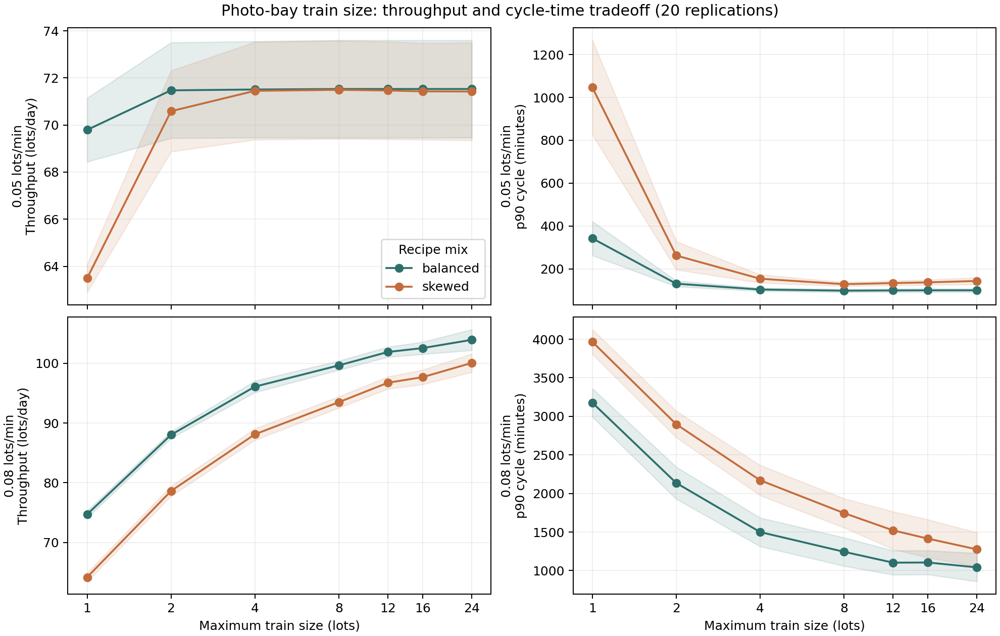

# FabSense

FabSense is a local workbench for an operations engineer who needs to inspect a result and the rows or assumptions behind it. It combines a photo-bay queue simulation, a gauge study, facility-meter anomaly checks and a restricted question interface over DuckDB. Those examples use seeded, generated data. Two separate public-data studies examine UCI SECOM yield records and NASA's simulated C-MAPSS turbofan trajectories.



## Why this project

An improvement in throughput is hard to trust if waiting time rises, the gauge is unreliable, or an energy alert has no source row to inspect. FabSense keeps those questions visible in one place and records the evidence behind each conclusion.

SECOM adds a different question: how well does a classifier trained on earlier recorded test points rank later in-house failures when only anonymous sensor columns are available? Its result is useful partly because it shows how model selection and a strict alert threshold can fail on a later slice.

The FD001 study asks whether recent sensor history can estimate cycles left before a simulated engine fails. It gives the workbench a concrete predictive-maintenance experiment while keeping aircraft simulation separate from fab equipment claims.

## Current milestones

| Area | What works today | Next question |
|---|---|---|
| Local operations studies | Seeded photo, gauge and facilities pipelines; row-cited DuckDB insights and a five-tab dashboard | How do these models behave with authorized site data? |
| Dashboard review | Each tab names a missing or malformed evidence file and its rebuild command instead of showing numbers. A headless-Chrome walkthrough (`make browser-test`) checks the five tabs, keyboard navigation, saved metrics and the empty-evidence state. An automated axe-core scan (`make a11y-scan`) found low-contrast captions and tab labels, fixed on 22 October; the remaining findings are in Streamlit's own page chrome and one widget attribute | Does it hold up in a manual screen-reader review? The scan is not a WCAG conformance claim |
| SECOM yield study | Chronological holdout and development-only model selection | Can a useful alert policy survive a new time window or site? |
| FD001 remaining-life study | Engine-separated validation and one official 100-engine endpoint result | Can it be checked on another fault mode before a maintenance use case is considered? |
| Neural RUL check on an untouched subset | A protocol committed before evaluation, then one FD003 test of FD001-trained models (23 October): an MLP over windowed features won FD001 development but lost clearly on FD003 (49.63 vs 27.23 RMSE), and the XGBoost baseline also degraded | Why do both models overpredict remaining life near failure under the fault-mode shift? FD002/FD004 are untouched, and no LSTM or CNN was tried |

## Run locally

You need Python 3.12.

```sh
python3.12 -m venv .venv
. .venv/bin/activate
pip install -r requirements.txt
make all
make test
```

`make dashboard` opens the Streamlit view. The browser walkthrough and accessibility scan need `pip install -r requirements-browser.txt` and an installed Google Chrome; [results](RESULTS.md) records their latest evidence. Its separate engine tab reads the committed FD001 aggregate evidence without retraining or loading raw engine data; it labels the study as simulated. The [query catalog](warehouse/QUERY_CATALOG.md) lists supported questions, while [results](RESULTS.md) records the seeded runs.

The two public-data runs are independent of `make all`:

```sh
.venv/bin/python -m pip install -r requirements-secom.txt
make secom
make cmapss
make cmapss-neural
```

`make secom` downloads UCI's CC BY 4.0 archive into ignored `data/raw/`, verifies its pinned SHA-256, and writes [a compact evidence file](evidence/secom_baseline.json). It uses a timestamp-ordered 1,253/314 development/test split with preprocessing inside five development folds. XGBoost was selected by development average precision, but reached only **0.0890** AP on the later test slice; the test positive-rate baseline was **0.0541**. Logistic regression reached **0.2250** AP on that same slice, but selecting it after reading the test would bias the result. All three models raised zero alerts under their development-selected 50% precision thresholds. [RESULTS.md](RESULTS.md) gives fold variation, review-capacity results and limits.

`make cmapss` downloads NASA's pinned FD001 archive into ignored `data/raw/` and writes [its evidence file](evidence/cmapss_fd001.json). It keeps whole engines apart for development validation and uses only earlier cycles in rolling sensor features. XGBoost was chosen from that validation split, then scored once at the 100 official test endpoints: **17.28-cycle RMSE**, against **49.82** for a fixed training-median reference. These are simulated turbofans, and the reference is deliberately simple. [RESULTS.md](RESULTS.md) gives the uncertainty interval, RUL slices and scoring limits.

`make cmapss-neural` follows [a protocol](docs/NEURAL_RUL_PROTOCOL.md) committed before any model saw FD003, a subset with one operating condition and two fault modes. It reuses the FD001 development split to compare the fixed XGBoost baseline with a scikit-learn MLP over flattened windows of recent sensor cycles (4 configurations × 5 seeds), then scores both once on FD003 and writes [its evidence file](evidence/cmapss_neural_fd003.json). The MLP was selected on development data (16.64 vs 20.77 RMSE), but on the 100 FD003 test engines it reached **49.63 ± 0.75 RMSE** over five seeds, against **27.23** for XGBoost and **49.80** for a constant. The paired bootstrap interval for the difference was +15.15 to +29.26 cycles. This is a negative result for the neural candidate under a fault-mode shift; the FD001 official test was not used again.

## Repository map

`fabstack/` contains the analyses, SECOM and FD001 baselines, and question router; `warehouse/` holds the SQL contract; `dashboards/` provides the viewer. [data/SOURCES.md](data/SOURCES.md) attributes both external sources and separates them from generated inputs.

## Scope

The photo, MSA and facilities inputs are generated, and those modules are not calibrated against a real fab. SECOM is a single historical public dataset with anonymous sensors and 17 failures in its later 314-row test slice. It does not establish a causal sensor explanation, a prospective yield screen, or an operating threshold. FD001 is one simulator setting with no physical-fleet validation or maintenance policy. A manual screen-reader review and the planned wafer-map, sequence-model (LSTM or CNN) RUL, FD002/FD004, fault-onset and public building studies remain open. The FD003 test labels have now been used once, so any further comparison on them is exploratory.
